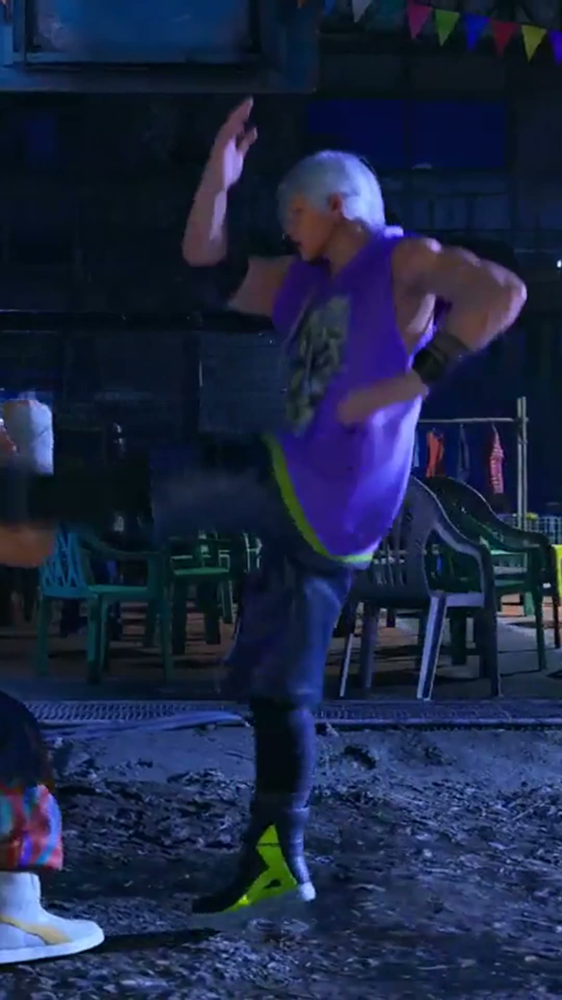

# clipforge

**Long video in → platform-ready vertical clips out. No AI, no API keys, no watermarks, no subscription — just ffmpeg and one Python file of dependencies: zero.**

Paid clippers charge $15–29/month to cut your long videos into Shorts/Reels — and put their watermark on your work until you pay. The open-source "AI" alternatives need an LLM key, a Whisper model download, and often a GPU. **clipforge is the honest basic tool underneath all of that:** you pick the moments (you know your content best), clipforge does the mechanical work — vertical reframe, brand logo overlay, burned-in captions, loudness normalization, batch rendering — in one command, on any machine that runs ffmpeg.


*A real clipforge output frame: 1080×1920, campaign logo overlaid for the first 6 seconds.*

## 60-second quickstart

```bash
# needs: python 3.9+ and ffmpeg on PATH
git clone https://github.com/lenevo02487/clipforge && cd clipforge

# one clip: from 0:50, 28 seconds long
python -m clipforge make trailer.mp4 --start 0:50 --duration 28 --out fight.mp4

# many clips at once, from a segments list
python -m clipforge batch trailer.mp4 segments.txt --logo brand.png --loudnorm
```

`segments.txt` is just lines of `start  duration  name`:

```
# start  length  name
50       28      hook_fight
1:35     30      finisher
```

That's the whole workflow. Outputs are 1080×1920 H.264 MP4s with faststart, ready to upload to YouTube Shorts, Instagram Reels, or TikTok.

## Features

- **Two reframe modes** — `crop` (center crop, fills the frame) or `pad` (your video centered over a blurred, darkened copy of itself — nothing gets cut off)
- **Brand/campaign logo overlay** — image pinned top-center for the first N seconds (`--logo`, `--logo-seconds`, `--logo-width`). Built for sponsored/campaign clips that require branding on screen
- **Batch mode** — cut a whole day of clips from one text file while you do something else
- **Burned-in captions** — pass an `.srt` timed to the full video (`--captions`); timing stays correct because seeking is done on the output side
- **Loudness normalization** (`--loudnorm`) — one flag, no more "too quiet on mobile"
- **Zero Python dependencies** — stdlib only. No pip install roulette, no API keys, no accounts, nothing leaves your machine
- **Tested** — 13 tests, including real end-to-end ffmpeg renders (`python -m unittest discover -s tests`)

## Why not an AI clipper?

| | clipforge | Hosted AI clippers (Opus Clip, Klap…) | Open-source AI clippers |
|---|---|---|---|
| Price | Free, MIT | $15–29/month | Free |
| Watermark | Never | On free/lower tiers | No |
| AI picks the moments | **No — you do** | Yes | Yes |
| Needs API key / GPU | No / No | No / No | Usually yes / often |
| Runs fully offline | Yes | No | Mostly |
| Your footage uploaded anywhere | Never | Yes | No |
| Campaign logo overlay + batch segments file | Built in | Editor-dependent | Rare |

clipforge deliberately does **not** pretend to find "viral moments" with AI. It is a sharp knife, not a robot chef. If you want AI highlight detection later, the roadmap below is honest about it.

## Options that matter

```
--start 0:50 --duration 28     timestamps accept seconds, mm:ss, or hh:mm:ss
--mode pad                     blurred-fill instead of cropping
--logo brand.png --logo-seconds 6
--captions subs.srt            burn in subtitles (full-video timing)
--loudnorm                     normalize audio loudness
--width 1080 --height 1920     any output size, not just 9:16
```

## Roadmap

- [ ] Scene-change based segment suggestions (ffmpeg `select` scene scores — still no AI)
- [ ] Optional Whisper captions as a separate extra, never a requirement
- [ ] Face-aware crop offset
- [ ] Config file for per-channel presets (logo, size, loudness)

## Contributing

PRs welcome — see [CONTRIBUTING.md](CONTRIBUTING.md). The bar: stdlib only, tests stay green, no feature that phones home.

## Who made this

Built by **Abhishek**, a Python automation freelancer who cuts campaign clips daily and got tired of paying rent on his own workflow. If clipforge saved you a subscription, consider a ⭐ — and if you need custom automation, you'll find me on GitHub Sponsors / [Gumroad](https://abhiphukan.gumroad.com).

## License

MIT — see [LICENSE](LICENSE). Use it for anything, including commercial work.
